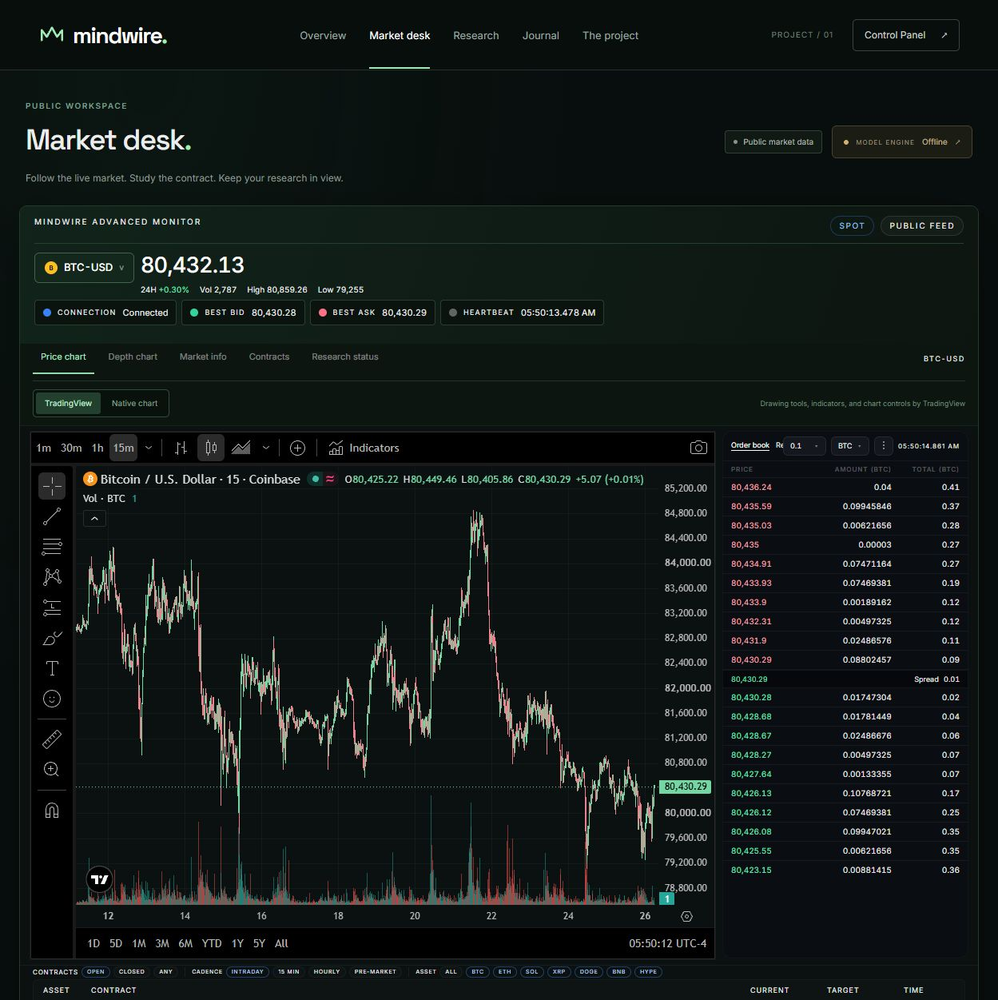

# Mindwire

I’m building Mindwire as a workspace for studying crypto event contracts: follow the underlying market, inspect the contract’s rules, record a probability before closing, and compare it with the final outcome.

The current application combines a live market desk, Kalshi contract research, and a browser-local forecast journal. **Version 1.2.0 has been verified locally. Trained-model inference is offline, and the application has not been deployed publicly.** This repository documents the project; it does not distribute the private implementation.

*Application capture from October 26, 2026. Prices are historical screenshot content. Chart controls and rendering are provided by TradingView; market data sources include Coinbase and Kalshi.*

## Explore the project

- [Current status and priorities](docs/status.md)
- [Architecture](docs/architecture.md)
- [Restoring a live market desk with an honest model boundary](case-studies/live-market-desk.md)
- [Recording forecasts before the outcome is known](case-studies/forecast-journal.md)
- [Verification record — October 26, 2026](verification/2026-10-26-v1.2.md)
- [Progress index](CHANGELOG.md)

## Direction

My priority is a useful research workflow whose claims can be traced to evidence. Live prices, manually recorded probabilities, and trained inference have separate meanings in the interface. The next modeling milestone is recovering or rebuilding a reproducible scorer and evaluating it before enabling model output.

Mindwire is an independent project. TradingView, Coinbase, and Kalshi are external providers, not project authors or sponsors.
