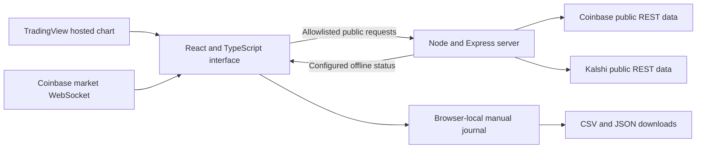

# Architecture

I kept the current application focused on public market research. The architecture separates market display, personal forecasting, and the unavailable trained scorer so that a working chart cannot imply a working model.

## System structure

Vite builds the interface, and the Node/Express server serves the production bundle and public-data routes from one origin. The development frontend uses the same proxy implementation. The server exposes no trading execution or credential-storage service.

## Data boundary

The proxy fixes each upstream host, matches a limited path pattern, and forwards only approved query parameters. Requests are read-only GET/HEAD; unknown routes and write methods are rejected. Successful responses have short caches, identical pending requests share work, and a bounded pending queue limits accumulated requests. Kalshi requests are spaced by 500 milliseconds, with a 12-second upstream timeout.

These controls reduce duplicate work and constrain what the server can request. They do not guarantee provider availability or establish capacity under production load. Source failures produce visible unavailable states. Missing numeric fields remain missing rather than becoming zero.

## Charts and order flow

TradingView supplies the default advanced chart, including drawing tools, indicators, and interval controls. Its feed cadence is controlled by the provider. A native chart uses Coinbase data, updates the active candle from live quotes, and periodically reconciles historical candles. The selected provider is remembered in the current browser.

The order book belongs to one selected product. Event-level product identifiers are checked before a snapshot clears the book or an update changes a level. Reconnection resets state and requires a fresh snapshot before incremental updates. This prevents late traffic from a previous asset from contaminating the current book. The [market desk case study](../case-studies/live-market-desk.md) explains the observed failure and its verification.

## Contract and forecast workflow

The catalog follows pagination and rejects repeated cursors or an exceeded safety bound rather than silently claiming a complete result. Contract pages keep source rules, quote history, closing time, and spot context together.

A forecast stores its original probability, note, contract snapshot, quote benchmark, and capture time. Outcome checks can revise settlement state without replacing the original forecast. Paired Brier comparisons use the same finalized records with valid captured benchmarks. The [journal case study](../case-studies/forecast-journal.md) describes the integrity rules and their limits.

Browser-local storage avoids an account service in this edition. The tradeoff is explicit: collections are tied to a browser and origin, have a 500-entry limit, and can be lost if site storage is cleared. Exports are available; import and server sync are not. Device time and local storage are user-controlled, so this is a personal notebook rather than a tamper-proof audit system.

## Model and administrator boundaries

The Model Engine component polls application health every 15 seconds. The endpoint explicitly reports inference as offline. This is a configured capability declaration, not a probe of an external model service; unknown health values become unavailable rather than live. Restoring model weights alone would not enable inference: the feature pipeline, scorer, provenance checks, and evaluation would also need to be completed.

The Control Panel displays “Admin access only.” Administrative and former bot/protected API paths return 403, while removed authentication and billing APIs are unavailable. No administrator sign-in or operational backend exists. I chose to keep those capabilities outside the current showcase scope so that the public research experience does not depend on missing services.
